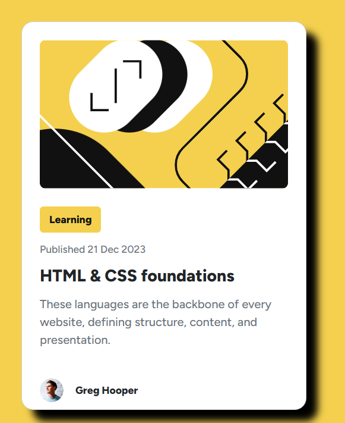
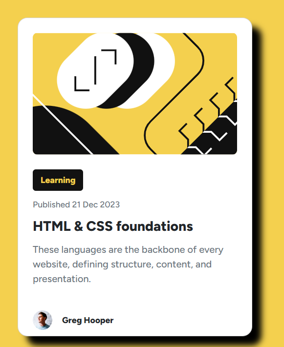

# Blog preview card

A single blog preview card on a yellow page. It shows an article illustration, a Learning label, the publish date, the title, a short summary, and the author.

## Description

Open `index.html` in a browser. Bootstrap and the Figtree font load from a CDN, so the page needs a network connection for those styles.

The card contains:

* Article image from `assets/images/illustration-article.svg`
* **Learning** label
* Published 21 Dec 2023
* Title: HTML & CSS foundations
* A one-sentence summary
* Greg Hooper, with `assets/images/image-avatar.webp`
* A footer that credits Frontend Mentor and Mamadou Moussa Balde

Hovering or focusing the Learning button turns it black with yellow text.

This is a solution to the [Blog preview card challenge on Frontend Mentor](https://www.frontendmentor.io/challenges/blog-preview-card-ckPaj01IcS).

## Screenshots

### The card

The illustration, article details, and author sit on a white card with a hard shadow.

### Learning label

## Getting Started

### Dependencies

* A browser
* A network connection, because Bootstrap and Figtree load from a CDN

### Installing

No install step.

### Executing program

Open `index.html` in a browser.

## Help

Without a network connection, Bootstrap and the Figtree font do not load. Hover or focus on Learning turns that button black with yellow text.

## Authors

[Mamadou Moussa Balde](https://www.linkedin.com/in/2mb/)

## Version History

* Current page
    * Frontend Mentor blog preview card
    * Published date on the card is 21 Dec 2023

## License

This folder does not include a `LICENSE.md` file.

## Acknowledgments

* [Frontend Mentor](https://www.frontendmentor.io/challenges/blog-preview-card-ckPaj01IcS)
* [Figtree](https://fonts.google.com/specimen/Figtree)
* [README template](https://gist.github.com/DomPizzie/7a5ff55ffa9081f2de27c315f5018afc)
